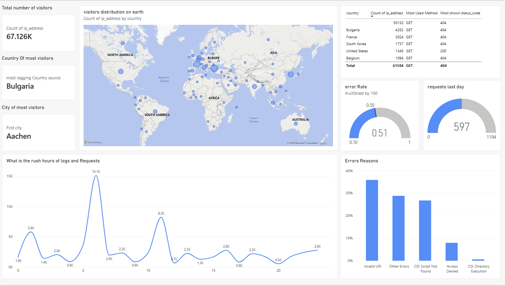
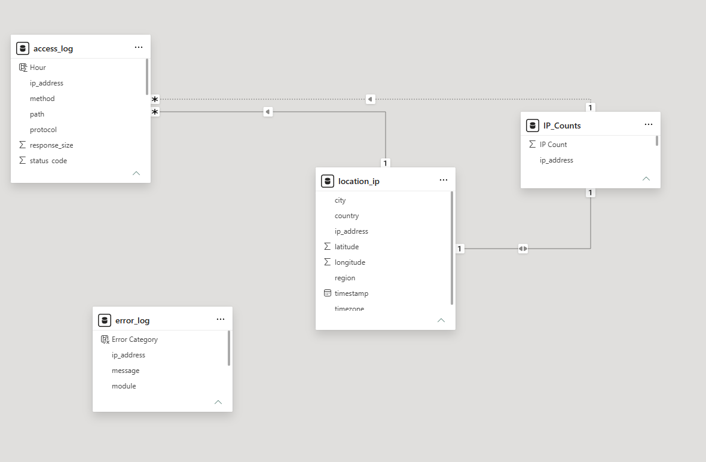
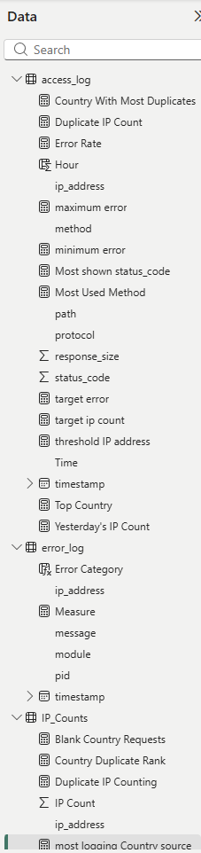

## The Questions Dashboard Tried to Answer:

1. What are the countries with the most visitors, and how many are they?

2. What is the total number of visitors last month?

3. What is the number of visitors last day, and did it exceed maximum capacity?

4. What are the rush hours of this website?

5. Did the error rate exceed the allowed KPI, and what are the main reasons for that error?

## Describtion of the tables

Originaly there are two tables 
1. access_log 
2. error_log

I derived the third table **Location_ip** from access_log by using python code that takes address_ip and return locations.

4. IP_count

Is an aggrigated table that help me find Country with most nimber of logs.

